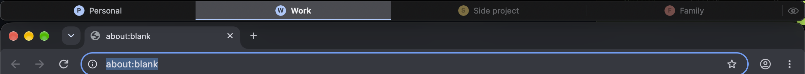
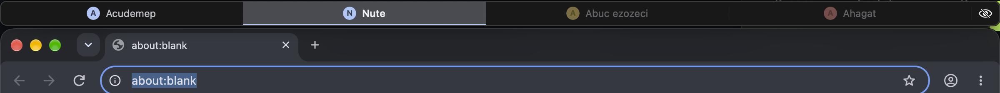

# Google Chrome Profile Tabs



Chrome keeps each profile in its own windows, and you switch between them through the profile menu. This app adds a row of tabs above the Chrome window, one tab per profile, like the project tabs in JetBrains IDEs. Click a tab and that profile's window takes the place of the current one, at the same position and size, so it looks like the window changed its content. If the profile has no open window, Chrome opens one in the same place.

It works on macOS 14 or later and on Windows 10 and 11.

## What it does

- Ctrl+1 to Ctrl+9 on macOS and Alt+1 to Alt+9 on Windows switch to the tab with that number while a Chrome window is in front. Other apps keep these keys. Windows gets Alt because Chrome there uses Ctrl+1 to Ctrl+9 for its own tabs.
- Tabs of profiles without an open window are paler.
- Drag a tab to change the order.
- Double-click a tab, or right-click it and choose Rename, to give it your own name. Enter saves, Esc cancels, and an empty name brings back the profile's name.
- The eye button on the right replaces every name with gibberish of the same length, for screen sharing. Click it again to get the names back. The setting survives a restart.
- Right-click a tab to hide it from the row. Hidden tabs come back from the same menu.
- If the Chrome window touches the top of the screen, it moves down by the height of the row and keeps its bottom edge. On Windows a maximized Chrome window becomes a window that fills the screen under the row.
- The row stays right above the Chrome window in the window stack, so a window that covers Chrome covers the row too. It hides when Chrome is minimized, in full screen or on another desktop.
- It starts at login. You can turn that off in the right-click menu.



## Download

Ready builds are on the [Releases](https://github.com/crmapache/google-chrome-profile-tabs/releases) page: a zip with the macOS app and the Windows exe. They are not signed by a registered developer, so both systems warn on the first start. On macOS, move the app to Applications and open it; when macOS refuses, open System Settings, Privacy & Security, and click Open Anyway. On Windows, if SmartScreen stops the exe, click More info and then Run anyway.

To build it yourself, see the sections below.

## macOS

You need macOS 14 or later and the Xcode command line tools.

```
cd macos
scripts/install.sh
```

This builds the app, copies it to /Applications and starts it. On the first start macOS asks for Accessibility access (System Settings, Privacy & Security, Accessibility). Without it the app can't see or move Chrome's windows. The row appears as soon as you turn access on.

macOS remembers this access by the app's signature. `scripts/build.sh` signs the app with the first Apple Development certificate in your keychain, or with the identity in `SIGN_IDENTITY`. If you have neither, the app is signed ad-hoc, and you will have to turn access on again after every rebuild.

macOS doesn't let apps read Chrome's files without Full Disk Access. So on macOS the app takes the list of profiles from Chrome's Profiles menu, and each tab gets a color of its own and the first letter of its name. If you add the app to Full Disk Access, it uses Chrome's profile colors, account photos and profile order.

## Windows

The app is a single exe without an installer. Build it with MinGW-w64, either on macOS or Linux as a cross build (`brew install mingw-w64` or `apt install mingw-w64`) or in an MSYS2 shell on Windows:

```
cd windows
./build.sh
```

Or with Visual Studio and CMake on Windows:

```
cd windows
cmake -B build
cmake --build build --config Release
```

Run `GoogleChromeProfileTabs.exe`. On the first run it adds itself to the programs that start with Windows (HKCU Run key). Its settings are in `HKCU\Software\GoogleChromeProfileTabs`.

## How it works

The app finds Chrome's windows and works out which profile each one belongs to.

On macOS it uses the Accessibility API. Chrome ends the accessibility title of a browser window with "- Google Chrome - Profile name". A window opened while Chrome had only one profile has no name there, so for it the app reads the label of the avatar button in the window's toolbar. A profile without a window is opened through Chrome's Profiles menu.

On Windows Chrome gives each profile its own taskbar group, and with it its own AppUserModelID: `Chrome` for the Default profile and `Chrome.UserData.Profile1` for "Profile 1". The app reads this id from each window, and the list of profiles, their colors and photos from Chrome's `Local State` file. A profile without a window is opened with `chrome.exe --profile-directory`. The app follows the window through SetWinEventHook, so the row moves together with the window.

On both systems the row is a separate window that never takes the keyboard, except while you rename a tab or use its menu. Afterwards the keyboard goes back to the window that had it.

## Testing without your Chrome

Both versions can work with a separate copy of Chrome and its own data folder, so you can try changes without touching your profiles. Set `GOOGLE_CHROME_PROFILE_TABS_BROWSER` to the browser (the `.app` on macOS, `chrome.exe` on Windows) and `GOOGLE_CHROME_PROFILE_TABS_USER_DATA` to the data folder, then start the app. The test copy keeps its own settings and does not touch the start at login.

## License

MIT
